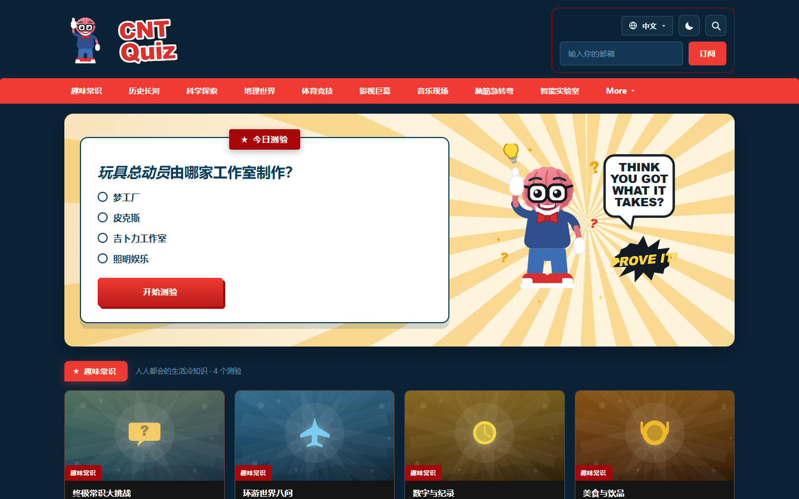
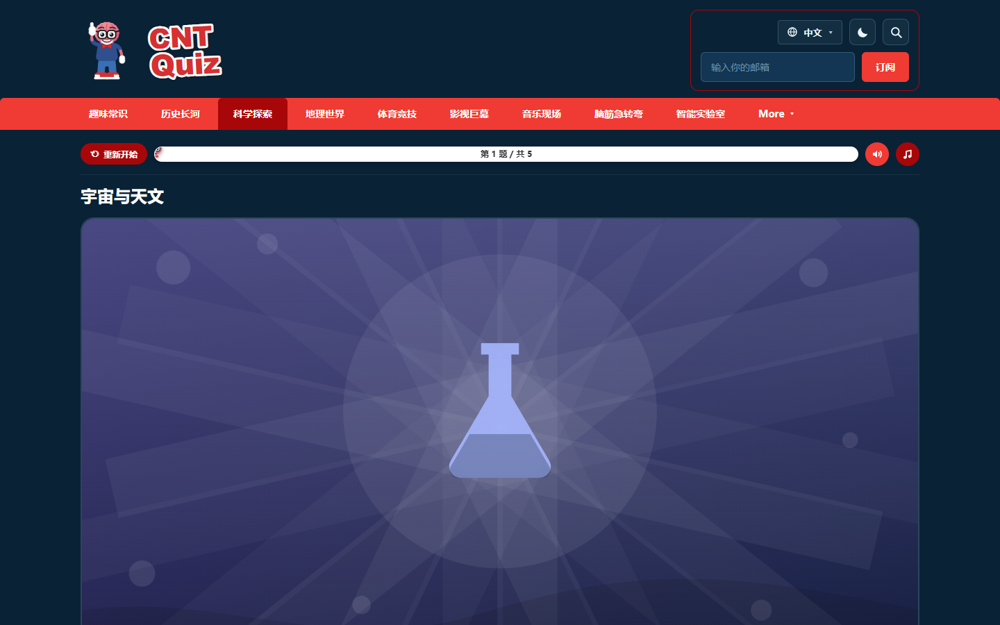
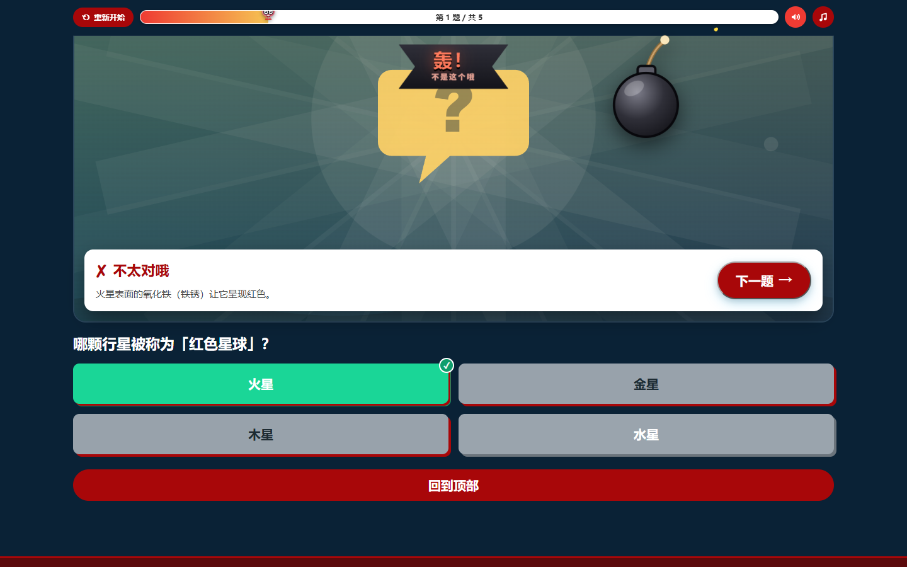
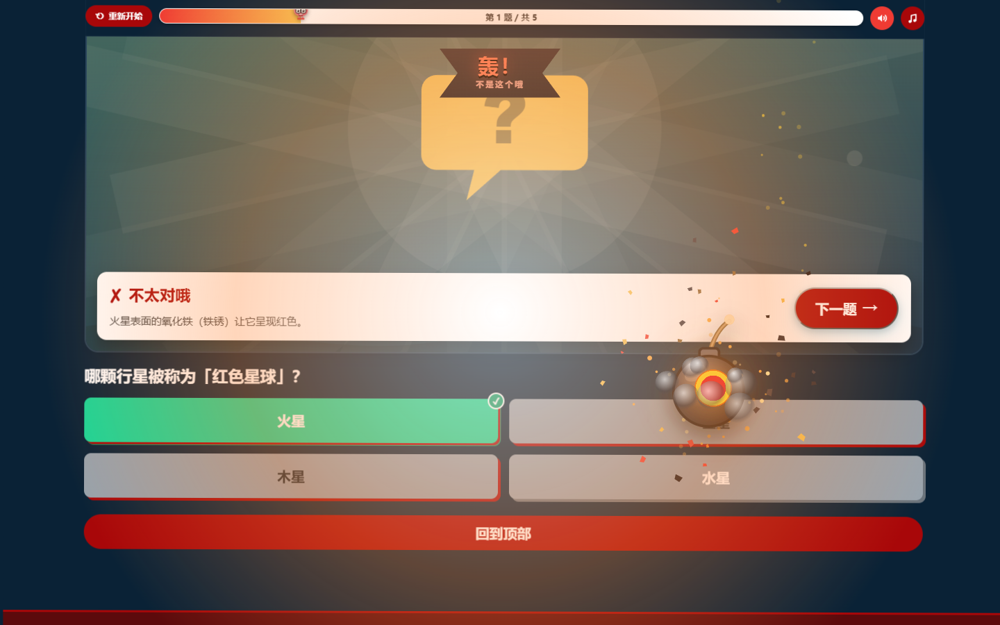
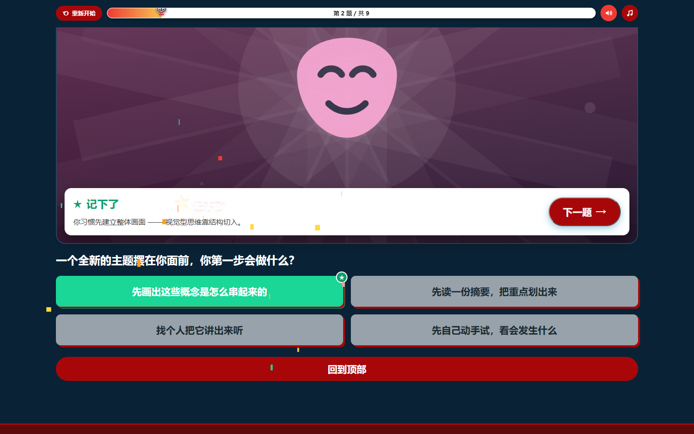
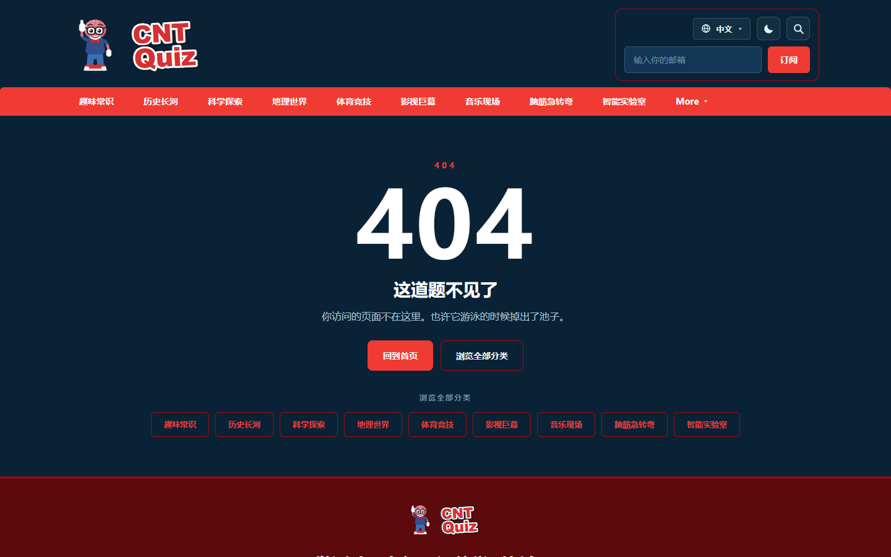
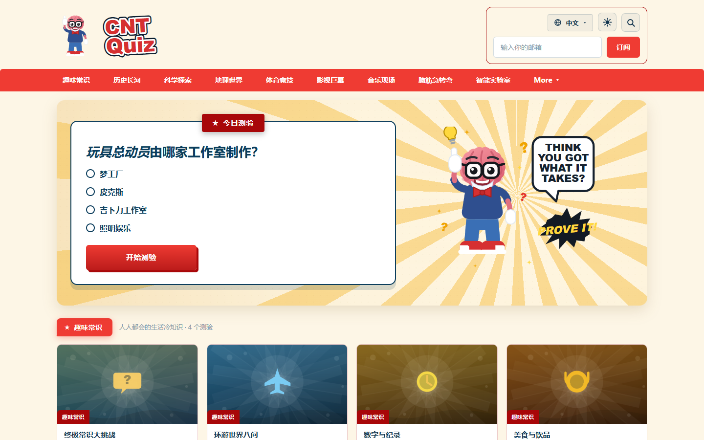
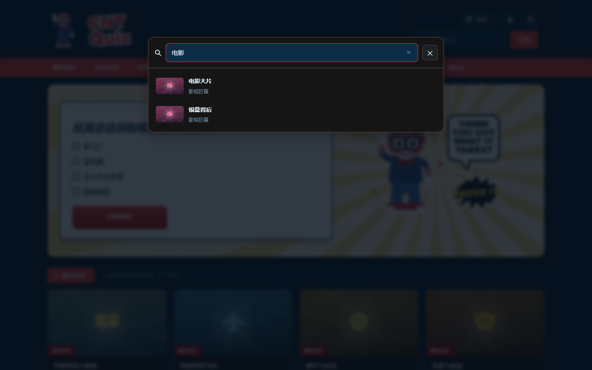

# CNT Quiz

多语言趣味问答网站（静态站），参考 [vibquiz.com](https://vibquiz.com/) 的风格与结构仿制。

> 🔗 **在线访问**：<https://wsttqs.github.io/cnt-quiz/>  （仓库：<https://github.com/wsttqs/cnt-quiz>）

```
.
├── web/        ← 网站本体（纯静态，零依赖、零构建）
├── preview/    ← 各页面 / 各特效的截图
├── docs/       ← 需求、调研、分析、实施方案文档
└── scripts/    ← Excel 模板生成与调试脚本
```

## 快速开始

```bash
node web/tools/serve.js 5173
# 打开 http://localhost:5173/
```

详见 [`web/README.md`](web/README.md)。

## 部署

本项目为纯静态站点，已配置 GitHub Actions 自动发布到 GitHub Pages（发布目录 `web/`）。详见 [`DEPLOY.md`](DEPLOY.md)。

**线上地址**：https://wsttqs.github.io/cnt-quiz/

通用格式为 `https://<用户名>.github.io/<仓库名>/`；每次 `git push` 后 Actions 会自动重新发布，约 1 分钟生效。

## 页面预览

| 页面 | 截图 |
| --- | --- |
| 首页 Hero |  |
| 答题页 |  |
| **答对 → 金色奖杯 + 彩带** |  |
| **答错 → 炸弹坠落** |  |
| **答错 → 爆炸 + 震屏** |  |
| 漏斗题（中性反馈） |  |
| 结果页 |  |
| 404 页 |  |
| 浅色主题 |  |
| 搜索浮层 |  |
| 移动端 |  |